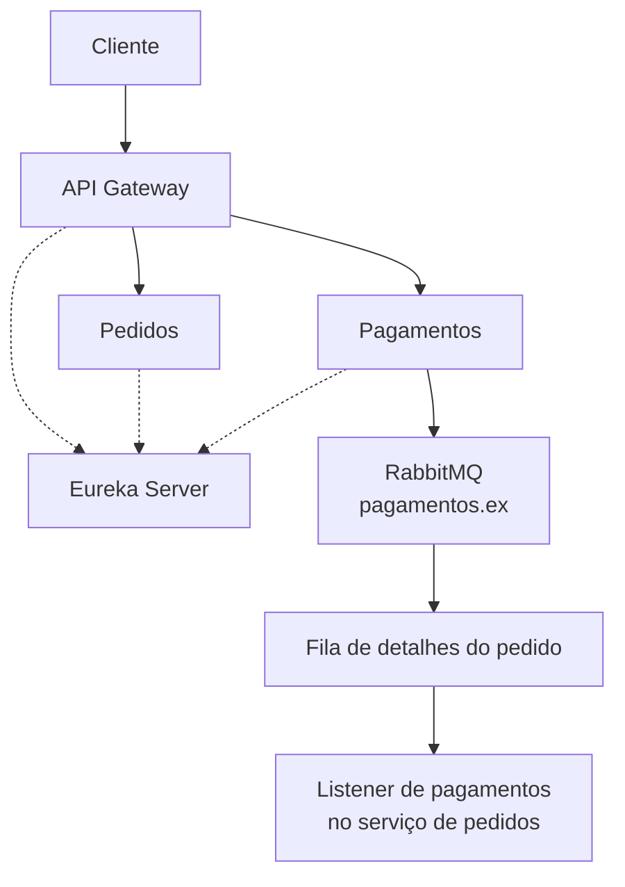

# AluraFood — Microsserviços com Java e Spring

Projeto de estudos em desenvolvimento backend com **Java, Spring Boot e Spring Cloud**, explorando arquitetura de microsserviços, descoberta de serviços, API Gateway e comunicação assíncrona com RabbitMQ.

O repositório reúne projetos independentes que exploram diferentes aspectos da construção e integração de aplicações distribuídas.

## Projetos

### Aplicação principal

A aplicação principal utiliza microsserviços para separar responsabilidades e explorar a descoberta dinâmica de serviços.

| Repositório | Descrição |
|---|---|
| [Gateway](https://github.com/pedrobuzolin/alurafood-gateway) | Centralização do acesso e roteamento de requisições para os serviços. |
| [Pedidos](https://github.com/pedrobuzolin/alurafood-pedidos) | API de gerenciamento de pedidos, com persistência de dados e consumo assíncrono de mensagens. |
| [Pagamentos](https://github.com/pedrobuzolin/alurafood-pagamento) | Gerenciamento de pagamentos e publicação de mensagens utilizando RabbitMQ. |
| [Server](https://github.com/pedrobuzolin/alurafood-server) | Servidor de descoberta de serviços utilizando Netflix Eureka. |

### Arquitetura da aplicação principal



O diagrama representa os principais componentes e o fluxo de mensageria implementado entre pagamentos e pedidos.

### Projeto independente: Avaliação

[**AluraFood Avaliação**](https://github.com/pedrobuzolin/alurafood-avaliacao)

Aplicação independente desenvolvida para estudar comunicação assíncrona com RabbitMQ, incluindo consumo de mensagens, configuração de exchanges e filas, além de tratamento de falhas com Dead Letter Exchange (DLX) e Dead Letter Queue (DLQ).

Esse serviço não integra a infraestrutura Eureka da aplicação principal.

## Tecnologias

- Java
- Spring Boot
- Spring Cloud
- Spring Cloud Gateway
- Netflix Eureka
- Spring Data JPA
- MySQL
- RabbitMQ
- Maven
- Git Submodules

As tecnologias e versões podem variar entre os repositórios.

## Como clonar

Clone o repositório incluindo os submódulos:

```bash
git clone --recurse-submodules https://github.com/pedrobuzolin/alurafood.git
cd alurafood
```

Se o repositório já tiver sido clonado sem inicializar os submódulos:

```bash
git submodule update --init --recursive
```

Cada projeto possui suas próprias configurações e instruções de execução. Consulte o README do respectivo repositório para configurar as dependências e iniciar o serviço.

## Objetivo

Consolidar conhecimentos em desenvolvimento backend com Java e explorar conceitos de arquitetura distribuída, integração entre microsserviços, descoberta de serviços e mensageria assíncrona.
